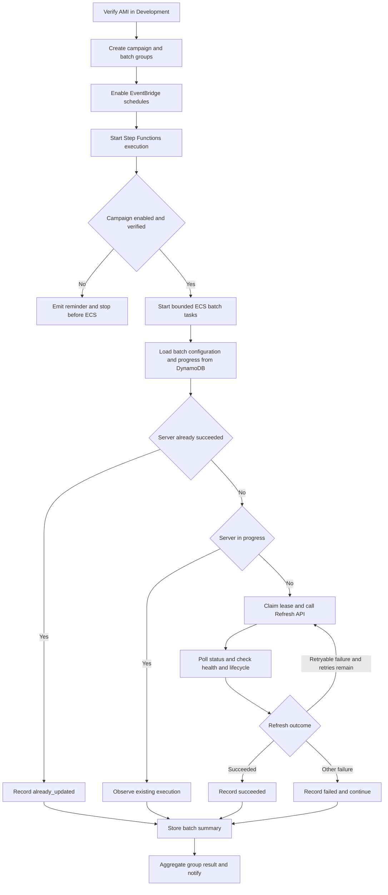
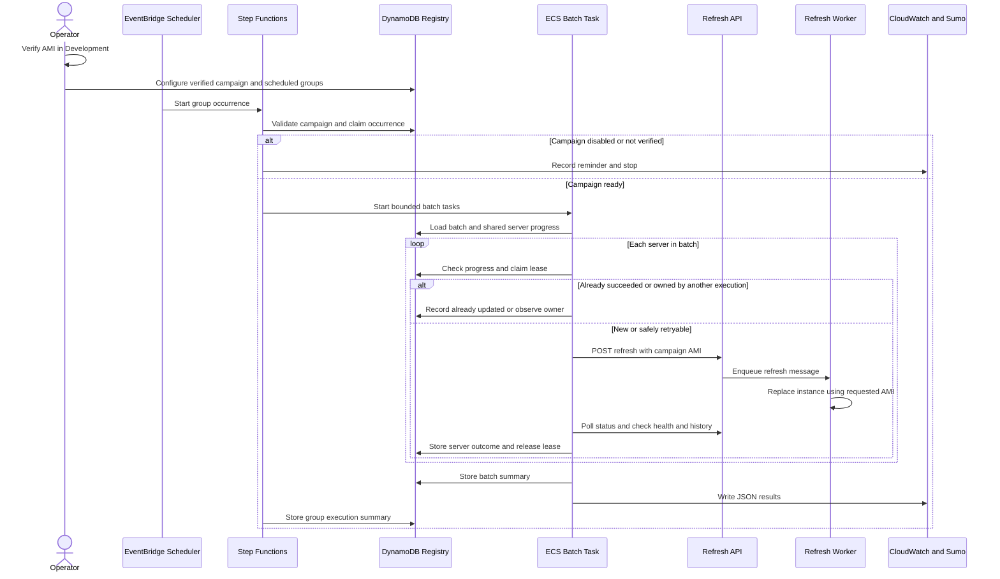

# Server Refresh Campaigns — Summary

**Source:** [server-refresh-batch-spec.md](./server-refresh-batch-spec.md)  
**Date:** 2026-10-20  
**Purpose:** Overview of the scheduled campaign design and operator workflow.

---

## Aim

Verify one candidate AMI in Development, then run a campaign with multiple independently scheduled batch groups. Each group can contain multiple bounded batches. The campaign registry tracks shared progress so repeated server IDs do not trigger duplicate refreshes.

| Today | This project adds |
|---|---|
| Failover and `refresh_server.py` use platform `LatestAMI` | `POST …/webserver/{id}/refresh` with a caller-supplied AMI |
| Manual or interactive refresh script | Non-interactive ECS batch tasks with polling, health checks, retries, and summaries |
| No required AMI verification process before rollout | A Development verification runbook and campaign-level `amiVerified` acknowledgement |
| One-off operator starts | EventBridge Scheduler, Step Functions Standard, and shared DynamoDB campaign progress |

**One-line takeaway:** Verify the AMI in Development, configure an immutable campaign and its scheduled groups, then let EventBridge start bounded ECS batches that record each server outcome in DynamoDB.

AMI verification is a required operator prerequisite, not a batch-task mode. The workflow checks the campaign's `amiVerified` acknowledgement and starts no ECS work if it is false. See the [AMI verification runbook](./server-refresh-ami-verification-runbook.md).

## Campaign and schedule

- One campaign represents one environment and one verified AMI. Its AMI is immutable.
- A campaign can have multiple named batch groups, each with its own schedule and server batches.
- Operators configure `maxServersPerBatch` for each batch group. Each batch contains a positive number of distinct server IDs up to that configured value. IDs may also appear in another group in the same campaign.
- `maxServersPerBatch` controls how many servers one ECS task processes sequentially; maximum concurrent batch tasks controls how many batches run at once. Batch size is checked against operational task-duration and capacity guardrails; the spec sets no fixed numeric maximum.
- EventBridge Scheduler starts a Step Functions Standard execution for each scheduled occurrence.
- The workflow validates campaign and group configuration, then starts ECS tasks with a configured concurrency limit.
- ECS tasks receive identifiers and read AMI, server IDs, and policy from DynamoDB. They do not receive an arbitrary AMI or server list through task overrides.

## Shared server progress and retries

DynamoDB is authoritative for campaign/server outcomes, executions, and environment/server leases.

| Existing campaign/server state | Behavior in a later group |
|---|---|
| Succeeded for the campaign AMI | Report `already_updated`; do not refresh again |
| In progress | Observe the existing owner up to the normal timeout; do not start a second refresh |
| Failed and still safely refreshable | Retry immediately under the current group's retry limit |
| Failed after the source reached `Deleted` | Report the terminal failure; do not call refresh again |
| No progress record | Conditionally claim the environment/server lease, then start the refresh |

Conditional leases prevent concurrent scheduled refreshes of the same environment/server. Active work renews its lease. Expiry/TTL is cleanup support, not a substitute for checking that the owner is no longer active before takeover.

Each batch continues after per-server failures. If every server has a recorded outcome, the task and workflow succeed; failed refreshes appear in the results and do not fail the batch. Infrastructure or orchestration failures that prevent reliable completion fail the workflow and are alerted separately.

## Requested AMI and replacement behavior

The requested `amiId` travels from the Refresh API message through the refresh worker and replacement-create path to EC2 `ImageId`. This refresh path does not resolve `LatestAMI` or `CertifiedAMIs`.

The worker may reuse a same-named `Copy-{name}-{id}` only when its AMI matches the requested AMI. A differing AMI makes it stale: delete it and create a replacement using the requested AMI. If the existing copy's AMI cannot be determined, fail rather than risk using the wrong image. Existing failover-based refreshes remain unchanged and continue to use the configured AMI.

## Three refresh paths

1. **Failover API** — AMI from platform config (`LatestAMI` / `ResolveAmi`).
2. **`refresh_server.py`** — Existing client of failover; unchanged.
3. **Scheduled campaign** — EventBridge → Step Functions → ECS → new Refresh Server API with campaign `amiId`.

## AMI verification prerequisite

Before creating or enabling a campaign, an operator refreshes one suitable Development server using the candidate AMI and completes the [runbook](./server-refresh-ami-verification-runbook.md):

1. The source reaches `Deleted` and the refresh lifecycle check passes.
2. The replacement EC2 instance's `ImageId` exactly matches the candidate.
3. Every site health check and applicable Development smoke check passes.
4. Evidence and the verified/not-verified decision are recorded.

Verification does not update `LatestAMI` or `CertifiedAMIs` and does not start a rollout. Set the campaign's `amiVerified` to true only after verification for that exact AMI. If the AMI changes, create a new campaign and repeat verification.

## Success per server

A server result is `succeeded` when the source reaches `Deleted`, every post-cutover site health check passes, and the required lifecycle events exist for the refresh message id. Other recorded outcomes are `failed`, `already_updated`, and `still_in_progress`.

## Workflow diagram

## Sequence diagram

## Exit codes

| Code | Meaning |
|---|---|
| 0 | Batch task recorded an outcome for every server; individual server failures remain in the summary |
| 1 | Unexpected runtime or operating-system failure |
| 2 | Infrastructure or orchestration failure prevented reliable completion |
| 3 | Workflow validation failed or campaign is disabled/unverified; no ECS task starts |

## Where to look after a run

1. CloudWatch log group `/xwing/server-refresh/{environment}`.
2. Sumo search by `batchId` for `BatchSummary` or `ServerResult`.
3. DynamoDB campaign/server progress and execution records for authoritative state.

## Deliberately out of scope

- SNS ingest, AMI copy, Certify, and writing `LatestAMI`.
- Patch-versus-major classification, Acumatica gates, AppConfig rollout policies, and automatic environment promotion.
- A custom campaign-management UI; campaign administration uses approved AWS administration tooling.
- Customer email, automatic rollout following verification, or changing the failover API and `refresh_server.py`.
