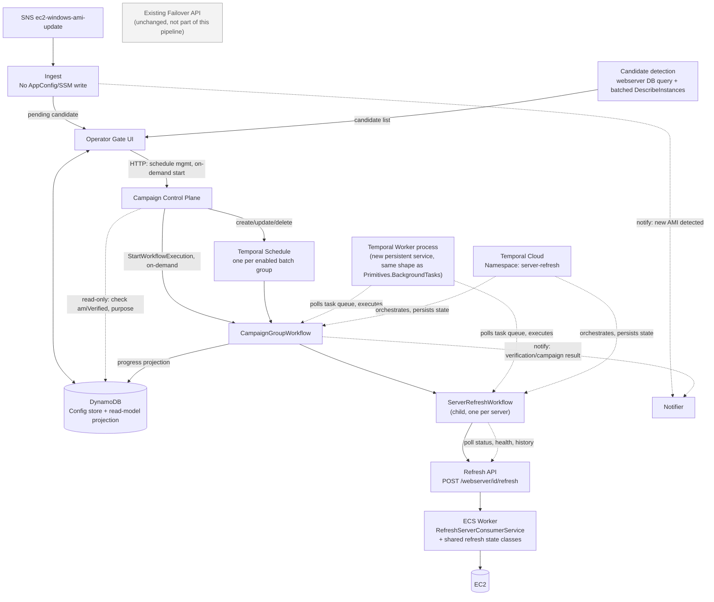
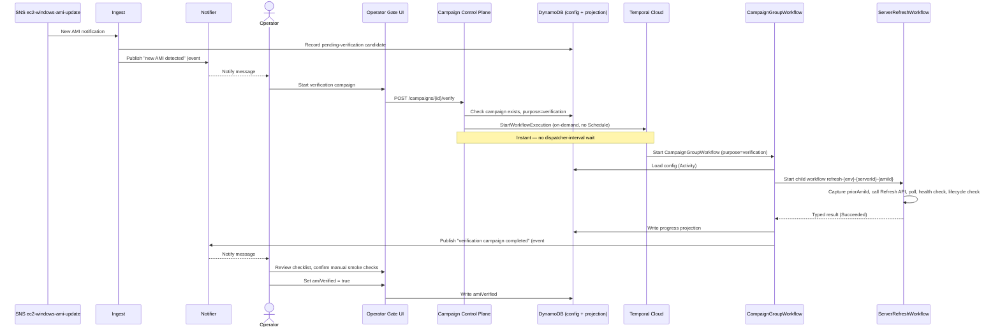
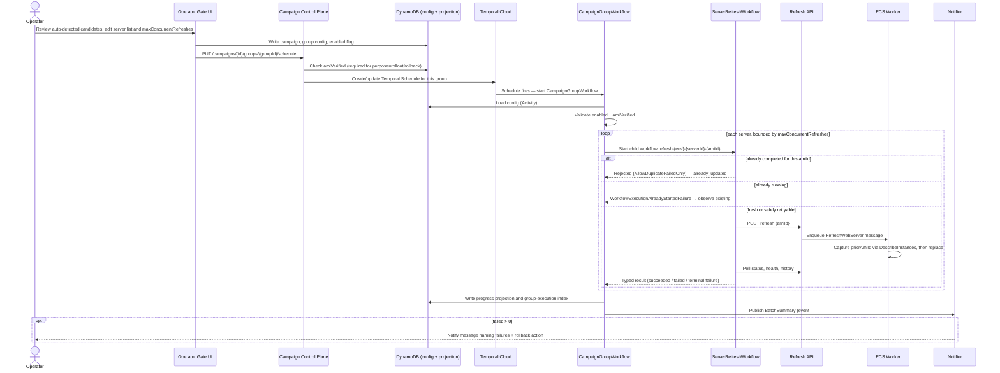
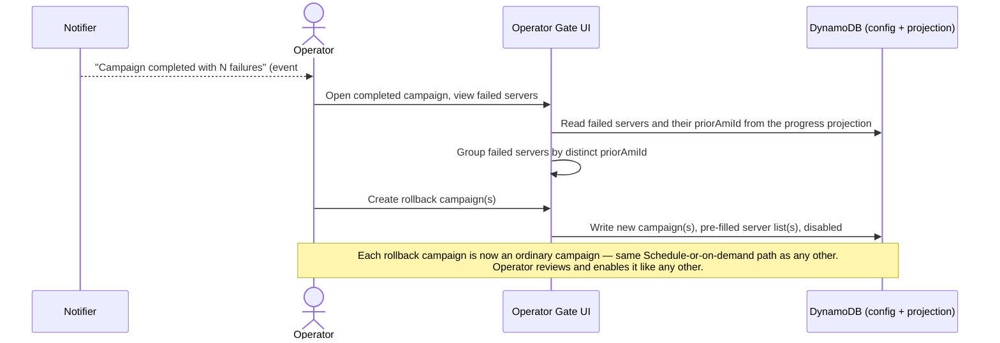
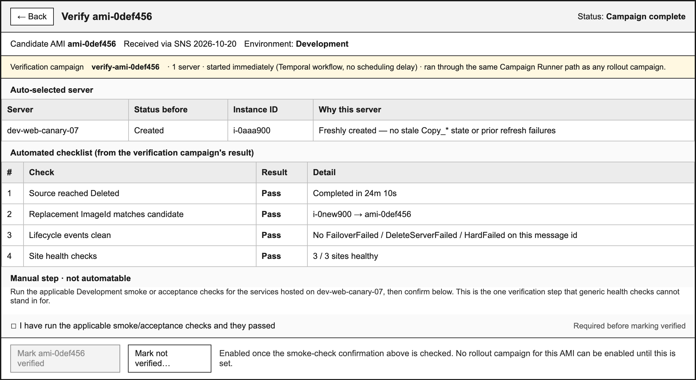

# Server Refresh Automation — Temporal Variant

**Status:** Draft for review
**Date:** 2026-10-21
**Audience:** Hosting engineers and operators
**Relationship to [server-refresh-automation.md](./server-refresh-automation.md):** Same product, same requirements, same four areas of effort. This document is an **alternative architecture** for two of them — Campaign Registry and Campaign Runner — built on **Temporal Cloud** (already provisioned and approved org-wide) instead of DynamoDB-as-execution-state, a single EventBridge-driven dispatcher, Step Functions Standard, and a hand-written ECS polling loop. AMI Ingestion, the Operator Gate UI, the Refresh API (XWING), Rollback, and Notifications are **unchanged in substance** and are restated here only where the orchestration swap touches their wording.
**Also see:** [server-refresh-ami-verification-runbook.md](./server-refresh-ami-verification-runbook.md)

This document assumes the reader has the context already established in `server-refresh-automation.md` Part 1 (the corrected facts about the XWING codebase — no AMI column, SSM not AppConfig, per-environment database naming, emergency-failover semantics). Those facts don't change based on the orchestration choice and aren't repeated here.

---

## Why this variant exists

Everything in `server-refresh-automation.md`'s Campaign Registry (DynamoDB) and Campaign Runner (dispatcher/Step Functions/ECS) sections is, underneath the AWS service names, hand-built durable-execution plumbing: a lease table with manual renewal and liveness checks, a retry-attempt counter, a scheduled-occurrence-id dedup scheme, and a polling loop with a hand-written heartbeat. That design was necessary when the only available primitives were EventBridge, Step Functions, and ECS. With Temporal Cloud already available, most of that plumbing is something the platform provides natively, and the resulting design is both simpler and more observable.

This is not free — see "What doesn't change" and the trade-offs noted inline — but with Temporal Cloud already provisioned, the switching cost that would normally argue for deferring this is largely gone.

---

## Architecture

The UI does **not** talk to Temporal Cloud directly. A new **Campaign Control Plane** — a .NET minimal API, the same framework family as `Primitives.Api` — sits in between and is the only component holding Temporal Cloud credentials.

A new, persistent **Temporal Worker process** is also required — a background service that polls Temporal's task queue and actually executes Workflow and Activity code. It is a new deployable, but not an unfamiliar shape: `Primitives.BackgroundTasks` is already exactly this kind of always-on worker service. The Control Plane and the Worker are two different things: the Control Plane is a synchronous request/response HTTP service the UI calls; the Worker is what actually runs Workflow/Activity code once Temporal schedules it.

### Campaign Control Plane

A thin, purpose-built .NET minimal API — not a general-purpose Temporal proxy. It exposes exactly the operations this product needs:

| Endpoint | Does |
|---|---|
| `POST /campaigns/{campaignId}/verify` | Starts an on-demand verification `CampaignGroupWorkflow` execution |
| `PUT /campaigns/{campaignId}/groups/{groupId}/schedule` | Creates or updates the group's Temporal Schedule |
| `DELETE /campaigns/{campaignId}/groups/{groupId}/schedule` | Disables/removes the group's Temporal Schedule |
| `GET /campaigns/{campaignId}/groups/{groupId}/runs` | Queries recent workflow executions and their status from Temporal, supplementing the DynamoDB progress projection with a live view when needed |

Why this exists rather than the UI backend embedding the Temporal SDK directly:

- **Consequence mismatch with a plain config write.** Writing a DynamoDB row is inert until something else acts on it. Calling Temporal starts a workflow that will actually begin replacing EC2 instances. That's a materially different risk than the plain config CRUD the UI backend already does against DynamoDB, and it's reasonable to give it its own, narrower boundary.
- **A real server-side invariant, not just indirection.** Before honoring a schedule-create/update or an on-demand start for a `rollout`- or `rollback`-purpose campaign, the Control Plane reads the campaign's `amiVerified` flag from DynamoDB and rejects the call if it isn't `true`. This is enforced here regardless of what the UI frontend/backend does or doesn't check — the same discipline this spec already applies elsewhere (e.g. the public `POST /webserver` route rejecting a caller-supplied `amiId` regardless of caller intent).
- **Credential isolation.** The Temporal Cloud mTLS client certificate lives only in the Control Plane's Secrets Manager scope. The UI backend — the highest change-velocity, most externally-reachable tier in this product — never holds it.
- **A narrow, stable contract.** The UI (or any future caller — a CLI, an automation) talks to four purpose-built endpoints instead of needing to know Temporal's SDK, workflow-id conventions, or reuse policies.
- **Testable independent of the UI.** Because it's a plain HTTP API with a small, well-defined contract, the orchestration logic — starting a verification campaign, creating/updating a schedule, the `amiVerified` gate rejecting an unverified rollout — can be exercised directly in integration tests, from a script, or with a tool like curl or Postman. Verifying this layer doesn't require the UI to be running at all, and isn't coupled to UI changes.

### AMI detection and verification sequence

### Forward refresh sequence

### Rollback sequence (operator-initiated, never automatic)

---

## What doesn't change

| Area | Status |
|---|---|
| AMI Ingestion — SNS subscription, candidate detection algorithm (DB query + batched `DescribeInstances`), verification-as-a-single-server-run, no AppConfig/SSM writes | Unchanged in substance (one wording update below) |
| Operator Gate UI — fleet/candidate views, batch editing, rollback action, verification action, access control (no EntraID gating) | Unchanged in substance (one write-surface update below) |
| Refresh API (XWING) — request format, status/guard rules, AMI-validation-is-upstream's-responsibility, consumer/shared-state-class design, stale-copy reuse fix, `priorAmiId` capture mechanism | **Fully unchanged.** This is XWING-side and has no dependency on which orchestrator calls it |
| Rollback — operator-initiated, grouped by distinct `priorAmiId`, never automatic | Unchanged in substance |
| Notifications — three events (new AMI, verification complete, campaign completed with failures), `IBatchSummaryPublisher`/Slack pattern | Unchanged in substance — now invoked from workflow/activity code instead of the ECS task, same effect |

For the full detail on all of the above, see `server-refresh-automation.md` Parts 4, 6, 8, 9. The rest of this document covers only what the Temporal adoption actually changes: the Campaign Registry data model and the Campaign Runner execution design.

---

## On-demand campaigns are now instant

One concrete improvement: in the EventBridge-based design, an on-demand campaign (verification being the only case) had to wait for the dispatcher's next tick — up to one dispatcher interval (e.g. 5 minutes) — because the UI could only write a flag to DynamoDB and something else had to notice it. With Temporal, the UI calls the Campaign Control Plane's `verify` endpoint, which calls `StartWorkflowExecution` immediately; there is no polling interval to wait out. Starting a verification campaign is now truly immediate — just with one extra, fast HTTP hop through the Control Plane instead of a raw client call.

(This also means wireframe `09`'s banner text changes from "started on-demand (next dispatcher tick)" to "started immediately" — see the Temporal-variant wireframe below.)

---

## Campaign Registry — Temporal variant

DynamoDB keeps the **operator-editable configuration** and a **read-model projection** for fast UI queries. It is no longer the source of truth for execution correctness — Temporal's own durable workflow state is.

| Record | Fields and purpose | Change from the EventBridge-based design |
|---|---|---|
| **Campaign** | `campaignId`, `environment`, immutable `amiId`, `amiVerified`, verification evidence reference, `purpose` (`verification` \| `rollout` \| `rollback`), enabled state, timestamps | Unchanged |
| **Batch group** | `campaignId`, `groupId`, enabled state, schedule expression + IANA time zone (these fields are literally what's used to create/update the matching Temporal Schedule), ordered `serverIds`, operator-editable `maxConcurrentRefreshes`, retry limit, polling interval, server timeout | **Simplified.** The old two-level "batch" (ordered `serverIds` chunked by `maxServersPerBatch`) plus "max concurrent batch tasks" existed specifically to fit ECS's execution model — one task processes one sequential list. Since each server is now its own independently-schedulable child workflow, there's no need for the sub-batch grouping at all: one flat, ordered server list per group plus a single concurrency bound (`maxConcurrentRefreshes`) replaces both `maxServersPerBatch` and `maxConcurrentBatchTasks` |
| **Progress projection** (read-model only) | `campaignId`, `serverId`, last known status/result, `priorAmiId`, updated-at | Replaces "Campaign/server progress" as a source of truth. Written by the workflow purely so the UI can list/query quickly without calling Temporal's visibility API on every page render. If this projection is ever missing or stale, Temporal's own workflow history for that server's deterministic workflow ID is the real answer |
| **Group execution index** (read-model only) | `campaignId`, `groupId`, Temporal workflow id, started/finished at, outcome | A thin index so the UI can list past runs for a group without constructing Temporal visibility-API queries for every view. Mostly replaces "Execution record" |
| **Environment/server lock** | — | **Removed entirely.** Replaced by giving each server's refresh a deterministic Temporal workflow id (`refresh-{environment}-{serverId}-{amiId}`) and relying on Temporal's workflow-id uniqueness — see below |

### Duplicate-server dedup, re-derived on Temporal's primitives

The same business rule as before (a server repeated across batch groups in one campaign must not be refreshed twice), re-expressed on top of what Temporal gives natively instead of a hand-rolled lease table:

| State for `refresh-{environment}-{serverId}-{amiId}` | Temporal mechanism | What the parent workflow does |
|---|---|---|
| Already completed successfully | Starting a workflow with this id and `WorkflowIdReusePolicy = AllowDuplicateFailedOnly` is rejected by Temporal | Catch the rejection, record `already_updated` |
| Currently running | Starting it returns `WorkflowExecutionAlreadyStartedFailure` | Catch it, then query/await the existing execution instead of starting a new one, up to the normal server timeout |
| Previously failed, safely retryable | `AllowDuplicateFailedOnly` permits starting a new execution with the same id | Start it, under the group's retry limit |
| Previously failed **after the source reached `Deleted`** (terminal) | **Not** a plain Temporal "failed" workflow outcome — the child workflow must complete with a typed result (e.g. `ServerRefreshOutcome.TerminalFailure`) specifically so it is *not* treated as retry-eligible by a later group | Inspect the typed result, record the terminal failure, do not start again |
| No prior execution for this id | — | Start fresh |

Worth being precise about that fourth row: Temporal's reuse-policy machinery only distinguishes "succeeded" from "failed" at the workflow-execution level. The business distinction this spec needs — *failed-and-retryable* vs. *failed-and-terminal-because-the-source-is-already-deleted* — doesn't come for free. The child workflow has to encode that distinction itself in its result type, and the parent workflow has to branch on it. Temporal removes the lease/lock plumbing; it doesn't remove the need to model this one business rule explicitly.

---

## Campaign Runner — Temporal variant

### Scheduling

One **Temporal Schedule** per enabled batch group, created/updated/deleted via the Campaign Control Plane whenever an operator edits a group's schedule or enabled flag. Creating a Schedule is a plain API call against Temporal Cloud, not an AWS infrastructure change, which is why — unlike the EventBridge design, which deliberately avoided per-group dynamically-provisioned schedule resources — a schedule-per-group is the natural, idiomatic approach here. Each Schedule starts a `CampaignGroupWorkflow` execution on its configured cron/rate expression and IANA time zone.

An on-demand campaign (verification) skips the Schedule entirely: the UI calls the Control Plane's `verify` endpoint, which calls `StartWorkflowExecution` directly.

### `CampaignGroupWorkflow`

One execution per scheduled or on-demand occurrence of a batch group. Responsibilities:

1. Load the campaign/group configuration via an Activity (Workflow code itself must be deterministic and cannot call DynamoDB or any external system directly — only Activities perform I/O).
2. Validate the campaign is enabled, `amiVerified` is true, and the environment matches. If not, complete immediately with a "not started — validation failed" result and emit the same reminder behavior as the EventBridge design's workflow validation step.
3. For each server id in the group's ordered list, start a `ServerRefreshWorkflow` child workflow with id `refresh-{environment}-{serverId}-{amiId}`, bounded by the group's `maxConcurrentRefreshes` (a simple windowed/semaphore pattern over child workflow starts — deterministic and safe in workflow code).
4. Apply the duplicate-server dedup table above for ids that already have an execution.
5. Collect each child's typed result; when every server has a recorded outcome, build the same `BatchSummary` shape the EventBridge design used and call the existing `IBatchSummaryPublisher` (Slack) — same notifier, same message content rules (explicit rollback call-out when `failed > 0`), just invoked from workflow/activity code instead of an ECS task's own process exit.
6. Write the progress projection and group-execution-index rows to DynamoDB (via an Activity) as it goes, so the UI has something fast to read.

### `ServerRefreshWorkflow` (child, one per server)

Replaces the ECS batch task's hand-written per-server loop. Activities:

- `CaptureSourceAmiActivity` — `DescribeInstances` on the source server's `instance_id`, records `priorAmiId`. Same mechanism, same timing (before the replacement is created) as the EventBridge design.
- `CallRefreshApiActivity` — `POST /webserver/{id}/refresh`. A transport error or HTTP 5xx is retried via a declared `RetryPolicy` on this Activity — this part genuinely is "free" under Temporal, replacing the hand-written retry-attempt counting.
- A poll loop calling `GetServerStatusActivity` (`GET /webserver/{id}?getFailoverInfo=true`) with `workflow.Sleep(pollIntervalSeconds)` between calls, logging a progress line on change and a heartbeat at least every 5 minutes — functionally identical to the old per-server loop, just expressed as ordinary workflow code with durable timers instead of a hand-managed poll/heartbeat state machine.
- `RunHealthChecksActivity` — `GET /website/health-check/{siteName}` per site, batched 10 at a time with 5 concurrent, exactly as before.
- `CheckLifecycleActivity` — `GET /history?messageId={id}`, same required-event table as `server-refresh-automation.md` Part 7 (`StartToHandleFailoverServer` always, `CreateServerForRefreshingServer` conditional, `CreateSitesOnOneServer`/`WaitingForCpuSettle`/`CpuSettled` conditional, `UpdateServerStatus`/`DeleteServer`/`Succeed` always; `FailoverFailed`/`DeleteServerFailed`/`HardFailed` fail the check).

Retry decision logic — **this stays workflow code, not a generic Activity retry policy**, because it depends on business state, not just "did the call fail": retry only when the terminal status is `FailingOverFailed` or the call itself transport-failed, up to the group's `retryLimit`; never retry once status is `Deleted` and health or lifecycle failed. The workflow loop makes this decision explicitly after inspecting each attempt's outcome, the same branching `server-refresh-automation.md` Part 7's retry table describes — Temporal gives you a clean place to put that logic (an ordinary loop with an `if`), not a way to avoid writing it.

The workflow's final result is one of: `Succeeded`, `Failed` (retryable within this execution's limit, but exhausted), `TerminalFailure` (post-`Deleted` health/lifecycle failure), `AlreadyUpdated`, or `StillInProgress` — the same five outcomes as the EventBridge design's `ServerResult`, just as a typed result instead of a DynamoDB row.

### What replaces the exit-code table

The EventBridge design's ECS task exit codes (0/1/2/3) existed because a *process* needed to signal an outcome to whatever started it. There's no analogous standalone process here — the Temporal Worker is a long-running service executing many workflow/activity tasks concurrently, and a single `CampaignGroupWorkflow` execution's own completion status (`Completed`, `Failed`, `Terminated`, `TimedOut`) plus its typed `BatchSummary` result is the direct replacement. An infrastructure/orchestration failure that would have been exit code 2 becomes a Workflow or Activity failure that exhausts its retries and surfaces in Temporal's own UI and, same as before, a separate alert.

### Logging

Activities still emit the same structured JSON log fields as the EventBridge design (`campaignId`, `groupId`, `serverId`, `attempt`, `messageId`, `status`, `result`, etc.) to stdout for CloudWatch/Sumo — Temporal's own execution history is excellent for "what happened to this one workflow" but teams still want business-log search across many executions in the tool they already use, so this isn't replaced, just supplemented. Temporal Cloud's own UI additionally gives a searchable, replay-capable history of every workflow and activity call, its inputs/outputs, retries, and timing, with no extra logging code required for that view.

---

## Operator Gate UI — updated write surface

One line from `server-refresh-automation.md` Part 6 changes. That document's "Write surface" rule was: *DynamoDB only — the UI never calls EventBridge or Step Functions directly.* Under this variant:

> **Write surface:** DynamoDB for configuration (campaign/group records, `amiVerified`, server lists) — unchanged — **plus the Campaign Control Plane** (HTTP) for schedule management and on-demand workflow starts. The UI never calls Temporal Cloud itself; the Control Plane is the only component holding Temporal credentials and is where the `amiVerified` invariant is enforced server-side.

Everything else in Part 6 (candidate detection display, batch editing, the rollback action, access control) is unchanged.

### Wireframe update

Wireframe `09` (AMI verification campaign) has one outdated line under the EventBridge design's assumptions. The Temporal-variant version:

Wireframes `06`, `07`, and `08` are unchanged — see `server-refresh-automation.md` Part 6 for those; nothing about their content depends on which orchestrator is running underneath.

---

## Requirements (changed or added from server-refresh-automation.md Part 10)

| ID | Requirement |
|---|---|
| FR-RUN-01T | Each enabled batch group shall have a corresponding Temporal Schedule, created/updated/deleted via the Campaign Control Plane. An on-demand (verification) campaign shall start via the Control Plane's `verify` endpoint calling `StartWorkflowExecution`, with no scheduling delay |
| FR-RUN-02T | Each server refresh shall run as a `ServerRefreshWorkflow` child execution with a deterministic workflow id of `refresh-{environment}-{serverId}-{amiId}`. Duplicate-server dedup across batch groups shall be implemented using Temporal's workflow-id uniqueness and `WorkflowIdReusePolicy`, per the dedup table above |
| FR-RUN-03T | The distinction between a retryable failure and a terminal failure (post-`Deleted` health/lifecycle failure) shall be encoded as a typed workflow result, not inferred from Temporal's own success/failure status alone |
| FR-RUN-04T | Transient infrastructure failures calling the Refresh API (transport error, HTTP 5xx) shall use a declared Activity `RetryPolicy`. The business rule governing retry-vs-terminal on `FailingOverFailed` vs. post-`Deleted` failure shall remain explicit workflow logic |
| FR-CTRL-01T | The Campaign Control Plane (.NET minimal API) shall be the only component holding Temporal Cloud credentials. Neither the Operator Gate UI backend nor any other component shall call Temporal Cloud directly |
| FR-CTRL-02T | Before creating/updating a Schedule or starting an on-demand workflow for a `rollout`- or `rollback`-purpose campaign, the Control Plane shall read that campaign's `amiVerified` flag from DynamoDB and reject the call if it is not `true`, independent of any check performed by the UI |
| FR-UI-06T | The Operator Gate UI shall call the Campaign Control Plane over HTTP for schedule management and on-demand workflow starts, in addition to its existing DynamoDB writes. It shall not embed a Temporal client or hold Temporal credentials |
| NFR-08T | A new, persistent Temporal Worker process shall be the only component executing Workflow and Activity code; Temporal Cloud itself holds no application code |
| NFR-09T | The Temporal Worker process shall retain the same narrow XWING route allowlist as the EventBridge design's ECS task (`/refresh`, `GET /webserver/{id}`, `GET /website/health-check/{siteName}`, `GET /history`) |
| NFR-10T | The Campaign Control Plane shall expose only its four purpose-built endpoints (verify, create/update schedule, delete schedule, get runs) — not a general-purpose Temporal proxy |

All requirements from `server-refresh-automation.md` Part 10 not superseded above (FR-ING-\*, FR-API-\*, FR-UI-01 through 05, NFR-01 through 07) apply unchanged.

---

## Acceptance (changed or added from server-refresh-automation.md Part 11)

1. Starting a verification campaign from the UI begins executing immediately — no multi-minute scheduling delay.
2. A server repeated across two batch groups in one campaign is refreshed at most once, enforced by Temporal workflow-id uniqueness rather than a DynamoDB lease table.
3. A server that fails after its source reaches `Deleted` is never retried by a later group, and this is verifiably encoded in that workflow's typed result, not inferred after the fact.
4. An operator can view a campaign/group's run history and per-activity detail directly in Temporal Cloud's UI, in addition to the existing CloudWatch/Sumo/DynamoDB views.
5. All acceptance criteria from `server-refresh-automation.md` Part 11 items 2–11 (fleet-source automation, batch editing, `priorAmiId` capture, rollback-campaign creation, unmodified `PUT /webserver/failover`, no AppConfig/SSM writes, the runbook-note-not-a-gate, and the three notifications) hold identically under this variant.

---

## Out of scope

- Self-hosting Temporal. This design assumes Temporal Cloud (already provisioned) exclusively.
- Everything already out of scope in `server-refresh-automation.md` Part 12.
- Migrating any other XWING workload onto Temporal. This document is scoped to the Campaign Registry and Campaign Runner only.

---

## Security notes

- The Temporal Worker process and the Campaign Control Plane both authenticate to Temporal Cloud via mTLS; each holds its own client certificate in AWS Secrets Manager, following the same pattern already specified for the Slack webhook — never in code, git, or logs. **No other component holds a Temporal credential**, including the Operator Gate UI backend.
- The Temporal Worker's IAM role is scoped identically to the EventBridge design's ECS task role: the same four XWING routes, nothing else. It cannot call failover, create, or delete, and cannot terminate EC2 instances.
- The Campaign Control Plane's IAM role grants Temporal Cloud access (its namespace only) and read-only DynamoDB access to the campaign config needed for the `amiVerified` check — nothing else. It has no XWING API access at all; it never calls the Refresh API, Failover, create, or delete.
- The Control Plane enforces the `amiVerified` invariant (FR-CTRL-02T) as a hard server-side check, not merely a UI-level convenience — a UI bug or a future second caller cannot bypass it.
- Workflow and Activity inputs/results (server ids, AMI ids, batch results) are General (AMBER), same classification as the rest of this product. No credentials, tokens, or customer data pass through Temporal or the Control Plane.
