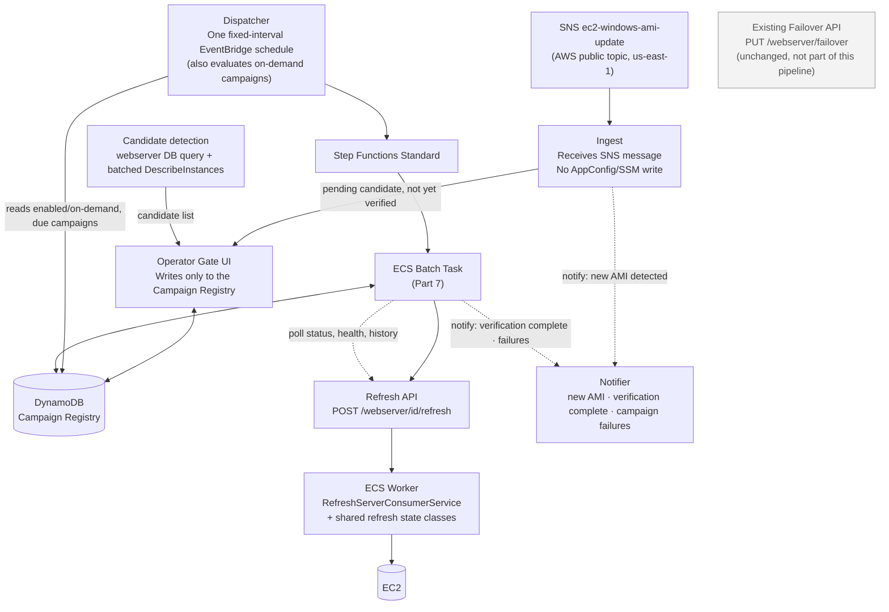
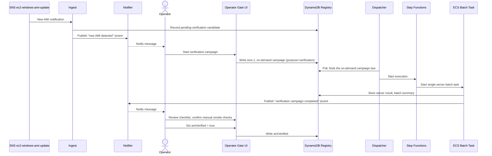
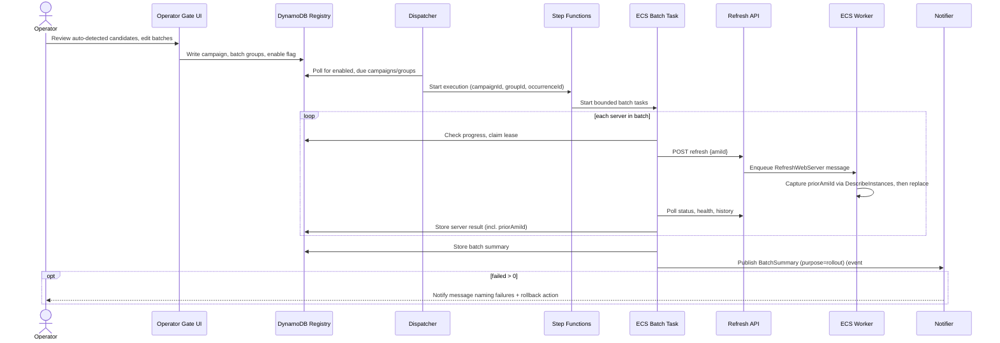
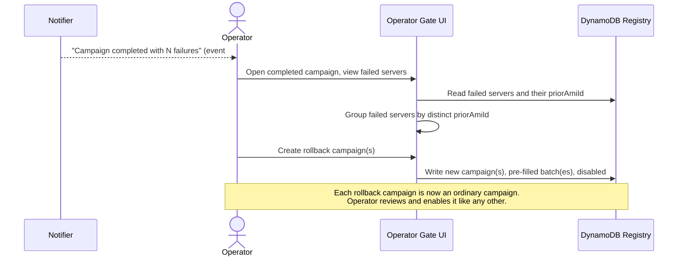
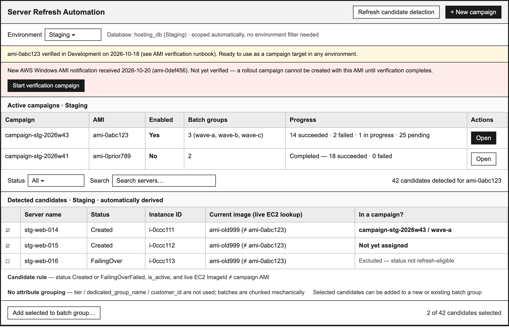
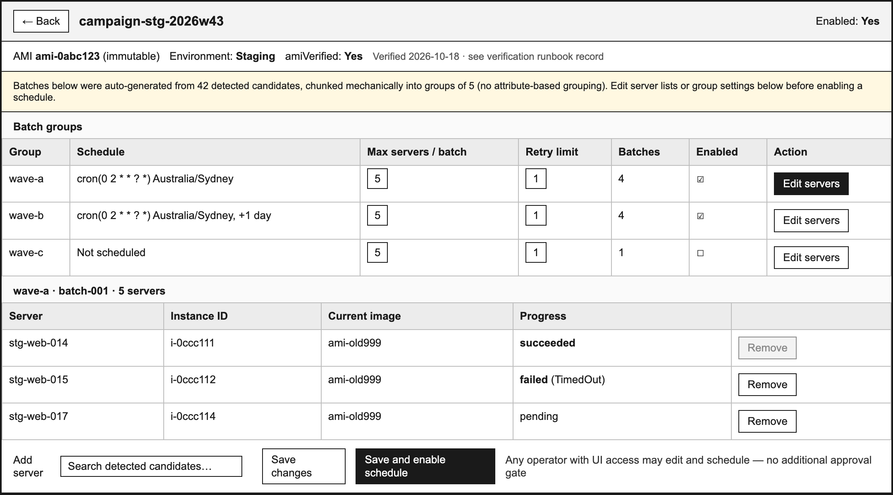
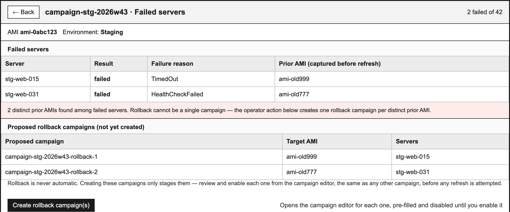
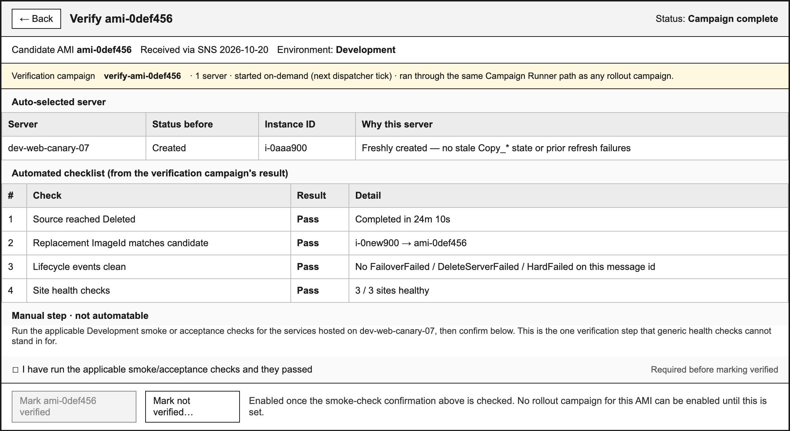

# Server Refresh Automation

**Status:** Draft for review
**Date:** 2026-10-21
**Audience:** Hosting engineers and operators
**Supersedes:** [server-refresh-automation-original.md](./server-refresh-automation-original.md) and [server-refresh-batch-spec-original.md](./server-refresh-batch-spec-original.md) / [server-refresh-batch-summary-original.md](./server-refresh-batch-summary-original.md) (all archived — their designs are fully restated below, adapted where this spec changes them — AMI validation ownership, automated candidate detection, dispatcher-based scheduling, `purpose` and `priorAmiId`, and notifications — so this document is the single source of truth and does not depend on any of them remaining available)
**Also see:** [server-refresh-ami-verification-runbook.md](./server-refresh-ami-verification-runbook.md) (still current — now triggered as a single-server verification campaign, Part 4)

This specification automates the server refresh process end to end: detecting a server fleet that needs a new AMI, letting an operator turn that into scheduled work, running that work without manual babysitting, and giving the operator an easy, deliberate way to recover if a rollout goes wrong. It replaces the manual, interactive `refresh_server.py` workflow for ongoing fleet rollouts; `refresh_server.py` and the existing Failover API remain supported, unmodified, for other uses.

The work is organized into four areas:

1. **AMI Ingestion** — detect a new AMI, trigger its one-time verification, automatically determine which servers need it.
2. **Operator Gate UI** — show AMI and fleet state, let an operator review/edit batches and schedule them, and make rollback easy when something fails.
3. **Campaign Runner** — the scheduling and execution machinery: a dispatcher, Step Functions, and bounded ECS batch tasks.
4. **Refresh API (XWING)** — the new, purpose-built endpoint the Campaign Runner calls, and how it relates to the existing Failover API.

---

## Part 1: Facts this spec is grounded in

The following were confirmed against the actual `advanced-platform-hosting` (XWING) codebase during planning, and correct some assumptions in earlier drafts.

| Topic | Fact |
|---|---|
| `webserver` table schema | Columns are `id, name, instance_id, status, subnet_id, enable_hyper_threading, tier, dedicated_group_name, customer_id, is_active`. **No AMI column exists, and none is added by this spec.** The only source of truth for "what AMI is this server running" is EC2 itself |
| AppConfig vs. SSM | `Configurations.AMIs.LatestAMI` / `CertifiedAMIs` are bound from **AWS Systems Manager Parameter Store** (`/enterprise-platform-api/{environment}/...`), not AWS AppConfig. AWS AppConfig is used elsewhere in this codebase only for unrelated feature flags. This spec does not write to that SSM parameter tree |
| Database naming | The database name is environment-specific (e.g. `hosting_db` in Production, `experimental_hosting_database` in Development/local) — never hardcoded; each environment is a fully separate deployment with its own database instance, so a query against "the" database is already scoped to that environment |
| `tier`, `dedicated_group_name`, `customer_id` | Observed to be mostly `NULL` in practice. Not usable for automatic classification or batch grouping |
| Emergency failover (`isRefreshServer=false`) | Creates **no new instance**. It migrates each site on the server independently onto other servers that already exist, then deletes the source server. It has no relationship to AMIs and is not touched by this spec |
| Planned refresh (`isRefreshServer=true`) | Creates one replacement instance, keeps its sites together, renames the old server `...-failover_{timestamp}` and terminates it. AMI is always resolved from config today — there is no way to override it |
| Existing automation gaps | No SNS listener for AMI notifications, no fleet-wide "list servers needing this AMI" query, and no per-day refresh-rate constant exist anywhere in XWING today. All are new work under this spec |
| Failure recovery today | A failed refresh (`FailingOverFailed`) does nothing but set that status — there is no rollback logic, and a retry re-resolves whatever AMI is configured *at that moment*, which may differ from what was configured at the original attempt |

---

## Part 2: Goals and non-goals

### Goals

1. Automatically determine, for a given environment and target AMI, which servers in the fleet need refreshing — no manual id lists.
2. Let an operator turn that candidate list into scheduled, bounded batches of work, with the ability to review and edit before anything runs.
3. Execute scheduled refreshes unattended, respecting a configurable per-batch size limit, with retries, health checks, and structured results.
4. Make recovering from a failed rollout a simple, low-friction, but always **operator-initiated** action.
5. Do all of this without writing to AppConfig/SSM AMI configuration, without an Acumatica-style software approval gate, and without a patch/major classification system.

### Non-goals

- Automating emergency failover (`isRefreshServer=false`) — unchanged, out of scope.
- Modifying the existing `PUT /webserver/failover` endpoint in any way.
- Automatic, unattended rollback — a rollback always starts from an explicit operator action.
- Customer notification/email (carried over from the original spec's scope, still not part of this one).
- Patch-vs-major AMI classification and an enforced Acumatica certification gate. Operators are told via the verification runbook to get the proper go-ahead before proceeding; nothing in the system checks or blocks on this.
- Role-based/EntraID-gated authorization for batch editing or schedule enabling. Any operator with access to the UI may edit and schedule.
- Fixing the pre-existing, unrelated dead `enableHyperThreading` parameter on the Failover API. Noted as out of scope technical debt.

---

## Part 3: Architecture



`refresh_server.py` and any human operator may still call `PUT /webserver/failover` directly at any time — that path is entirely unaffected and is shown above only for contrast.

**There is no separate verification system.** A new AMI's first-ever campaign is always a single-server **verification campaign**, started directly by the operator in the UI, and it runs through exactly the same `DISPATCH → SF → ECS → API → WORKER` path as any other campaign — see Part 4.

### AMI detection and verification sequence



### Forward refresh sequence



### Rollback sequence (operator-initiated, never automatic)



---

## Part 4: AMI Ingestion

| Behaviour | Detail |
|---|---|
| Trigger | SNS `ec2-windows-ami-update` (`arn:aws:sns:us-east-1:801119661308:ec2-windows-ami-update`), via a subscription this spec adds — nothing today subscribes to it |
| On receipt | Record the candidate AMI as "pending verification." Does **not** write `LatestAMI`, `CertifiedAMIs`, or any SSM parameter. Does not classify patch vs. major |
| Verification | A single-server **verification campaign**, started by the operator in the UI — see below. No separate manual-polling system. The runbook gains one line: the operator must get the proper organizational go-ahead before proceeding. This is a documentation note, not a system-enforced gate |
| Candidate (fleet) detection | Fully automated, described below. Replaces manual server-id curation |
| Notification | Every new candidate triggers event #1 of the three notification events in Part 7 — operators are told a new AMI needs attention rather than having to discover it by checking the UI |

### Verification is a single-server campaign, not a separate procedure

Before any rollout campaign may use a new candidate AMI, it must be verified. This no longer means a parallel, hand-polled procedure — it is the same Campaign Runner/Refresh API machinery as any other campaign, scoped to exactly one server:

1. The operator opens the pending candidate in the Operator Gate UI and selects **"Start verification campaign."**
2. The UI auto-selects one Development server in `Created` status (preferring a freshly created one, per the runbook's existing guidance) and writes a size-1 campaign record to DynamoDB, flagged to run on the dispatcher's **next tick** rather than waiting for a cron/rate schedule. This keeps the UI's write-only-to-DynamoDB rule intact (Part 6) — there is no separate "start now" API call into Step Functions; "on-demand" is just another kind of "due now" the dispatcher already has to evaluate (Part 7).
3. The dispatcher picks it up on its next tick and runs it through the identical `Dispatcher → Step Functions → ECS batch task → Refresh API → ECS worker` path as any rollout campaign — same polling, same health checks, same lifecycle check, no new mechanism.
4. Once complete, the UI presents the result as a checklist mirroring the [AMI verification runbook](./server-refresh-ami-verification-runbook.md): did the source reach `Deleted`? Does the replacement's `ImageId` match the candidate? Are lifecycle events clean? Did every site health check pass?
5. The one runbook item that cannot be mechanized — "applicable Development smoke or acceptance checks" for the hosted application — remains a manual step the operator performs and confirms in the UI. Automated health checks can't catch an OS-level regression that breaks the hosted application's own behavior without ever failing a generic health check.
6. The operator reviews the full picture (automated checklist plus manual smoke-check confirmation) and manually sets `amiVerified: true` on the campaign. This sign-off stays a deliberate human action — consistent with this spec's decision not to build a software-enforced approval gate (Part 2, Non-goals).

The verification runbook document's role changes accordingly: instead of a manual, hand-polled procedure, it becomes the checklist and evidence record referenced in steps 4–6 above.

### Candidate detection algorithm

For a given environment and target `amiId`:

1. Query that environment's own database (no environment column needed — each environment is already a separate database):
   `SELECT id, instance_id FROM webserver WHERE status IN ('Created', 'FailingOverFailed') AND is_active = 1`
2. Batch the resulting `instance_id` values into `DescribeInstances` calls (up to ~1000 ids per call — a multi-thousand-server fleet is a handful of calls, not thousands).
3. Any server whose live `ImageId` ≠ the target `amiId` is a genuine candidate.
4. Candidates are presented to the operator in the Operator Gate UI, chunked **mechanically** into batches of a configurable `maxServersPerBatch` — no grouping by `tier`, `dedicated_group_name`, or `customer_id`, since those fields are not reliably populated.

This is the only place AMI comparison happens against live EC2 state; nothing is inferred from the database alone, because the database has no AMI field.

---

## Part 5: Campaign Registry (DynamoDB)

DynamoDB is the authoritative registry for rollout configuration and progress. A campaign represents one rollout of one AMI in one environment, for one of three purposes (verification, rollout, or rollback — Part 4/9). Multiple named batch groups can belong to a campaign and have independent schedules, so operators may add a later group without first listing every server in the campaign.

| Record | Fields and purpose |
|---|---|
| **Campaign** | `campaignId`, `environment`, immutable `amiId`, `amiVerified`, verification evidence reference, enabled state, **`purpose`** (`verification` \| `rollout` \| `rollback` — set at creation, used by the UI to choose which view to render and by the notifier to choose the right message template), and timestamps. Verification is required (`amiVerified: true`) before any `rollout` or `rollback` group starts — a `verification`-purpose campaign is exempt from this check against itself, since it's what produces that evidence. Changing the AMI creates a new campaign and requires verification again |
| **Batch group** | `campaignId`, `groupId`, enabled state, an **on-demand flag** (for a verification campaign, run on the dispatcher's next tick instead of waiting on a schedule), schedule expression, IANA time zone, batch definitions, **operator-editable** `maxServersPerBatch` (no fixed numeric maximum is prescribed — validated only against operational task-duration and capacity guardrails), retry limit, polling interval, server timeout, and maximum concurrent batch tasks |
| **Batch definition** | `batchId`, ordered `serverIds` — **auto-populated from candidate detection (Part 4) by default**, and freely editable by the operator afterward (add, remove, or move servers between batches). Each batch has a positive number of distinct server IDs no greater than its group's `maxServersPerBatch`. Server IDs may repeat in different groups of the same campaign |
| **Campaign/server progress** | Keyed by `campaignId` and `serverId`; stores AMI, status, attempt count, current execution and lease, latest message id, timestamps, last result, and **`priorAmiId`** — the server's `ImageId` captured via `DescribeInstances` immediately before the refresh replacement is created, stored permanently (not just used transiently) so a later rollback campaign can read it |
| **Execution record** | Unique scheduled-occurrence id, campaign/group ids, start/end times, per-batch summaries, and infrastructure error details |
| **Environment/server lock** | Conditional lease keyed by environment and server id, with campaign, group, execution owner, and expiry. Prevents concurrent refreshes across all campaigns scheduled in that environment |

The implementation may use one DynamoDB table with partition/sort keys and conditional writes. Campaign and group definitions remain while configured, including while paused. Archive or delete a campaign explicitly; do not expire successful per-server records while later groups may still run. Retain execution records for an agreed audit period (90 days is the initial target). Locks are renewed while work is active and released at terminal outcomes. DynamoDB TTL is eventual cleanup only; an expired lease must be checked against owner liveness before takeover.

Unlike a design where campaign/group administration happens through "approved AWS administration tooling," **every write here comes from the Operator Gate UI** (Part 6) via conditional writes — campaign creation, batch editing, and schedule enabling are all ordinary UI actions, not AWS console/CLI operations.

### Duplicate-server and retry behavior

Repeated server IDs across batch groups in the same campaign are allowed and deduplicated by campaign/server progress:

| State when a group reaches a server | Behavior |
|---|---|
| `succeeded` for this campaign and AMI | Do not refresh again. Record `already_updated` in this batch and count it complete |
| `in_progress` | Do not start another refresh. Observe the existing execution up to the normal server timeout and report its terminal result. If still running at timeout, record `still_in_progress` and leave its owner's lease intact |
| `failed` and safely refreshable | Retry immediately under this group's retry limit |
| `failed` after source reached `Deleted` | Report the terminal failure; do not call refresh again |
| No campaign/server progress | Atomically claim the environment/server lease, then start the refresh |

Acquire the global environment/server lease with a conditional DynamoDB write before any refresh call. Renew it while processing and release it at terminal outcome. Another group encountering an active lease observes that owner rather than issuing a duplicate refresh. This protects scheduled jobs; manual failover/refresh paths rely on the API's own status guards unless separately integrated with the lock.

Retry immediately after a transport failure, HTTP 5xx, or `FailingOverFailed`, up to `retryLimit` additional attempts. A server reaching `Deleted` but failing health or lifecycle checks is recorded `failed` and is **not** retried in that execution, because its source is already deleted and the API cannot safely start another replacement on top of it — that failure is exactly what feeds a later, operator-initiated rollback campaign (Part 9).

### Execution state, batch completion, and outcomes

Each ECS batch task processes every server in its list, including after individual refresh failures. It writes one `ServerResult` per server and one `BatchSummary`; summaries and progress are stored in DynamoDB and logs go to stdout, CloudWatch, Sumo, and the notifier (Part 7).

Per-server result values are `succeeded`, `failed`, `already_updated`, or `still_in_progress`, with attempts, final status, message id, and failure reason. A batch task exits successfully after processing every server to a recorded outcome — server refresh failures are business results and do not fail the task or Step Functions execution. Infrastructure/orchestration failures that prevent reliable completion fail the task/workflow and are alerted separately. Later schedules observe in-progress work and retry only prior failures that remain safely refreshable.

Before refresh work begins, the workflow conditionally creates its execution record. For each server, the ECS task conditionally claims the environment/server lease before calling the Refresh API. Duplicate scheduled-occurrence ids do not start a second execution.

A group's execution is `completed` when every server in its configured batches has a recorded outcome, including per-server failures. Infrastructure failures are recorded separately and may leave an execution requiring recovery; the next occurrence (scheduled or on-demand) reconciles registry state before retrying work. Results contain no credentials or token-bearing URLs.

---

## Part 6: Operator Gate UI

| Capability | Detail |
|---|---|
| AMI and fleet state | Shows verification status (from the verification campaign's evidence) and live candidate detection results per environment/AMI |
| Verification | **"Start verification campaign"** on any pending candidate AMI — auto-selects one Development server in `Created` status and writes a size-1, run-on-next-tick campaign record. Once it completes, the UI shows the automated checklist and lets the operator confirm the manual smoke-check step and set `amiVerified` |
| Batch review and editing | Operators can view auto-generated batches, move servers between them, add/remove servers, and adjust `maxServersPerBatch` and retry limits per group, before enabling a schedule |
| Write surface | **DynamoDB only.** The UI never calls EventBridge or Step Functions directly — it only ever writes campaign/group/batch records and flips `enabled`/`amiVerified`/on-demand flags. A single, fixed-interval dispatcher (Part 7) is the only thing that turns an enabled, due, or on-demand record into an actual execution |
| Access control | None beyond baseline UI login. No EntraID group gating on editing or scheduling — see Non-goals |
| Rollback | A **"Create rollback campaign"** action on any completed campaign's failed-servers view. Groups failed servers by their recorded `priorAmiId` (handling the case where failed servers don't share one prior AMI), and pre-fills one new, disabled campaign per group — ready for the operator to review and enable like any other campaign. Never automatic |

### Wireframes

Plain, static mockups (shared `wireframe.css`, also under `wireframes/` for anyone who wants to open these as real HTML files) — embedded here in full so this document is the complete, standalone source.

#### Campaign & fleet overview

Environment selector, AMI/verification state, active campaigns, auto-detected candidates.



#### Campaign detail — batch groups

Editable batch groups, server lists, and per-group settings before enabling a schedule.



#### Failed servers — create rollback campaign

Failed servers grouped by distinct `priorAmiId`, with one-click rollback-campaign creation.



#### AMI verification campaign

Starting a single-server verification campaign and reviewing its result checklist before setting `amiVerified`.



---

## Part 7: Campaign Runner

### Dispatcher (replaces per-group EventBridge Scheduler resources)

A **single, IaC-provisioned EventBridge schedule**, at a fixed short interval (e.g. every 5 minutes), invokes a lightweight dispatcher. The dispatcher:

1. Reads all enabled campaign/group records from DynamoDB, including any flagged **on-demand** (e.g. a newly-created verification campaign).
2. Evaluates each group's own configured cron/rate expression and IANA time zone against the current time — an on-demand record is simply always due.
3. Starts a Step Functions Standard execution, with a unique scheduled-occurrence id, for any group that's due. Duplicate scheduled-occurrence ids never start a second execution (Part 5) — this is what keeps the dispatcher's own ticking safe to run unattended.

An on-demand campaign (verification being the only case today) therefore starts on the dispatcher's next tick, not instantly — an acceptable trade-off of up to one dispatcher interval against keeping the UI's write surface limited to DynamoDB (no direct Step Functions call from the UI).

This keeps all scheduling state in one place (DynamoDB), gives the UI nothing to provision or deprovision in AWS directly, and means an operator editing a cron expression is a plain conditional write, not an AWS control-plane call.

### ECS batch task: runtime

| Item | Value |
|---|---|
| Language | C# |
| Target framework | `net10.0` |
| Language version | C# 14 |
| Nullable | enabled |
| Warnings | errors |
| Process | Generic host worker, one batch task, then exit |
| Logs | `ILogger` JSON formatter to stdout and stderr only |

The Primitives API and the existing background worker stay on their current `net9.0` target — this spec does not upgrade those projects. The task is a separate project, `ServerRefresh.BatchTask`, and talks to XWING only over HTTPS.

### Hosting API targets

| `environment` | Base URL |
|---|---|
| `development` | `https://platform.dev.myob-edops.com` |
| `staging` | `https://platform.staging.myob-edops.com` |
| `production` | `https://platform.myob-edops.com` |

The task signs with AWS SigV4, service `execute-api`, region `ap-southeast-2`, using the task role's temporary credentials. The base URL comes from the matched environment; campaign data cannot supply a URL. The task role may invoke only:

- `POST /api/hosting/v1/webserver/{webServerId}/refresh`
- `GET /api/hosting/v1/webserver/{webServerId}`
- `GET /api/hosting/v1/website/health-check/{siteName}`
- `GET /api/hosting/v1/history`

It cannot call failover, create, or delete, and it cannot terminate EC2 instances. The worker performs the instance replacement.

### Per-server loop

For each server id in a batch:

1. Log `ServerStarted` with the attempt number (attempt 1 is the first try).
2. `POST` the refresh command with the campaign's `amiId`.
3. Store the message id from a 202 that enqueued work.
4. Poll `GET /webserver/{id}?getFailoverInfo=true` at `pollIntervalSeconds`.
5. Log a progress line when status, migrated count, or failed count changes, and one heartbeat at least every 5 minutes while the server is still running.
6. Stop polling at `Deleted`, `FailingOverFailed`, or `serverTimeoutMinutes`.

A good result is all of the following:

- Source status is `Deleted`.
- Every site returned for that server passes `GET /website/health-check/{siteName}?isAlert=false&isSimpleCheck=false`. An empty site list passes this check.
- The lifecycle check below passes.

Health checks run after the server reaches `Deleted`, including when that server is the last id in the batch. Sites are checked in batches of 10, with at most 5 calls in flight. Each site result is one JSON log line. A failed health check fails the server; it does not roll the server back — the source id is already `Deleted`, so the task does not send another refresh for that id (that failure is exactly what a later, operator-initiated rollback campaign addresses — Part 9).

### Lifecycle check

After `Deleted`, the task reads history for the refresh message id returned at accept: `GET /api/hosting/v1/history?messageId={messageId}`. Those rows use resource `RefreshWebServer`. The create event may point its reference id at the replacement server, so a query by the source server id is not the check — the message id is.

The refresh is lifecycle-valid when that message's rows contain:

| Event | When it is required |
|---|---|
| `StartToHandleFailoverServer` | Always |
| `CreateServerForRefreshingServer` | When this attempt created a replacement, including when it first deleted a same-named copy because that copy used a different AMI. Reusing a copy already running the requested AMI does not need a second create event on this message id |
| `CreateSitesOnOneServer` | When the pre-terminal poll showed at least one eligible site |
| `WaitingForCpuSettle` and `CpuSettled` | When the pre-terminal poll showed at least one active site |
| `UpdateServerStatus` | Always |
| `DeleteServer` | Always |
| `Succeed` | Always |

`FailoverFailed`, `DeleteServerFailed`, and `HardFailed` on this message id fail the lifecycle check.

The task captures the site snapshot on the first successful poll after accept. A site is eligible when its status is not a progress website status and its install is not `DeletedForFailover` (the same rule as `StatusHelper.IsProgressWebsiteStatus` in the worker). An active site is an eligible site with `isActive` true. That snapshot decides which conditional events are required above. The message-id query already excludes older refreshes of the same server.

### Retries

`retryLimit` is the number of extra attempts after the first.

| `retryLimit` | Maximum attempts |
|---|---|
| 0 | 1 |
| 1 | 2 |
| 2 | 3 |
| 3 | 4 |

The task retries only when another refresh call can start work: the `POST` failed because of a transport error or an HTTP 5xx, or the terminal status is `FailingOverFailed`. It waits until the status is terminal before the next `POST` — a status of `FailingOver` means a second `POST` would return 202 and enqueue nothing, so that is not a retry.

It does **not** retry when status is `Deleted` and health or lifecycle failed — that outcome is final for that server id, because the source has already been deleted and the API cannot safely start another replacement on top of it. Each attempt is logged with `attempt` and `maxAttempts`. The task never displays interactive prompts or reads from stdin.

Before calling the Refresh API for a server, the task captures and records that server's current `ImageId` as `priorAmiId` (Part 8) — additive to this loop, not a change to its control flow. Once a server's configured `retryLimit` is exhausted, it is recorded `failed` and the batch moves on. **Nothing in the Campaign Runner initiates a rollback.** Recovery is always the operator's decision, made in the UI (Part 6).

### Logging

Every line is one JSON object on stdout. Fields: `timestamp`, `level`, `eventType`, `campaignId`, `groupId`, `batchId`, `executionId`, `environment`, `amiId`, `serverId`, `attempt`, `messageId`, `status`, `result`, `message`. `executionId` uniquely identifies one scheduled or on-demand occurrence. Omit empty fields rather than writing secrets. Never log the SigV4 authorization header, session tokens, webhook URLs, or health-check URLs that carry query tokens. Do not clear the console, write ANSI control sequences, or draw a refreshed table — CloudWatch and Sumo need an append-only stream.

### Batch summary and exit codes

When a batch finishes, the task writes one `BatchSummary` log event and stores the same object in DynamoDB:

```json
{
  "eventType": "BatchSummary",
  "campaignId": "stg-2026w43",
  "groupId": "wave-a",
  "batchId": "batch-001",
  "executionId": "scheduled-occurrence-uuid",
  "environment": "staging",
  "amiId": "ami-0abc123",
  "purpose": "rollout",
  "startedAt": "2026-10-21T01:00:00Z",
  "finishedAt": "2026-10-21T02:10:00Z",
  "durationSeconds": 4200,
  "succeeded": 4,
  "failed": 1,
  "alreadyUpdated": 0,
  "stillInProgress": 0,
  "servers": [
    {
      "serverId": 322,
      "result": "succeeded",
      "attempts": 1,
      "finalStatus": "Deleted",
      "healthPassed": true,
      "lifecyclePassed": true,
      "priorAmiId": "ami-old999",
      "messageId": "queue-message-id",
      "failureReason": null
    }
  ]
}
```

`result` is `succeeded`, `failed`, `already_updated`, or `still_in_progress`. `failureReason` is a short stable code: `RefreshRejected`, `RefreshFailed`, `TimedOut`, `HealthCheckFailed`, `LifecycleInvalid`, `TransportError`, `LockConflict`.

| Exit code | Who sets it | Meaning |
|---|---|---|
| 0 | Task | Batch finished and every server has a recorded outcome. Individual server failures are reported in the summary and do not fail the task |
| 1 | Runtime / OS | Unexpected failure — crash, unhandled exception, or process kill. The task never assigns this code for a normal business outcome |
| 2 | Task/workflow | Infrastructure or orchestration failure prevented reliable completion; individual server refresh failures do not use this code |
| 3 | Workflow | Campaign is not verified/enabled or registry/configuration validation failed; no ECS task is started |

### Notifier interface

```csharp
public interface IBatchSummaryPublisher
{
    Task PublishAsync(BatchSummary summary, CancellationToken cancellationToken);
}
```

`SlackBatchSummaryPublisher` is the first implementation — it posts the summary text to the refresh channel (`#prj-web-hosting-server-refresh`). The webhook URL is read from AWS Secrets Manager at startup; the secret name is task configuration, never a field in campaign data. A publisher failure is logged and retried with bounded backoff, at most 3 times — the server results and exit code never change because the notifier was unavailable; the stdout `BatchSummary` line and DynamoDB result record are already written. Replacing Slack means a new implementation of `IBatchSummaryPublisher` and a different secret; callers stay on `BatchSummary`.

### CloudWatch and Sumo

The task definition uses the `awslogs` driver and no other log driver.

| Environment | Log group |
|---|---|
| Development | `/xwing/server-refresh/development` |
| Staging | `/xwing/server-refresh/staging` |
| Production | `/xwing/server-refresh/production` |

Retention is 90 days. A subscription filter on each group delivers the stream to Sumo. Sumo searches use `eventType = BatchSummary` for the batch result and `eventType = ServerResult` for each server (written for every id when that id's loop finishes, using the same server object that later appears in `BatchSummary.servers`). Operators check a run in three places: the CloudWatch log stream, the Sumo search for `batchId`, and the DynamoDB execution and campaign/server result records.

### Notifications

Automated detection is only useful if operators find out about it without having to poll the UI. Three events are notified, reusing one mechanism:

| # | Event | Fired by | Trigger | Message content |
|---|---|---|---|---|
| 1 | New AMI detected, pending verification | Ingest | A new candidate AMI is recorded (Part 4) | AMI id, SNS receipt time, and a pointer to start a verification campaign |
| 2 | Verification campaign completed | Campaign Runner | A campaign with `purpose = verification` finishes its one batch | Pass/fail outcome and a link to the checklist screen for sign-off (wireframe `09`) |
| 3 | Campaign completed with failures | Campaign Runner | Any batch/group execution finishes with `failed > 0` | Failure count and reasons, with an explicit call-out pointing to the failed-servers / rollback-campaign action (wireframe `08`) when `purpose = rollout` or `rollback` |

Event #3 is not new machinery — the ECS batch task already publishes a `BatchSummary` through `IBatchSummaryPublisher` after every batch (see "Notifier interface" above). This spec only changes its message content: when `failed > 0`, the text explicitly names the rollback action rather than reading as a generic result line.

Events #1 and #2 need a notifier call where none exists today. Ingest is a Lambda, not an ECS batch task, so it has no `BatchSummary` to publish — it gets its own small interface following the same shape and discipline as `IBatchSummaryPublisher`: `IRegistryEventPublisher.PublishAsync(event, cancellationToken)`, with a Slack implementation as the first subscriber, same webhook secret (AWS Secrets Manager), same channel (`#prj-web-hosting-server-refresh`), same bounded-retry-then-log-and-move-on discipline — a notification failure never blocks ingestion, verification, or a rollout. Event #2 is mechanically just event #3's existing publish path with `purpose = verification`, since a verification campaign is a size-1 campaign like any other (Part 4).

---

## Part 8: Refresh API (XWING)

### API-internal comparison with the existing Failover API

| | `Failover(isRefreshServer=true)` (existing, unchanged) | `POST /webserver/{id}/refresh` (new) |
|---|---|---|
| AMI source | `WebServerParameterResolver.ResolveAmi()` reads `Configurations.AMIs.LatestAMI`/`CertifiedAMIs` from config | Caller-supplied `amiId` in the request body; config is never read |
| Route / method | `PUT .../webserver/failover?webServerId=X&isRefreshServer=true[&enableHyperThreading=Y]` | `POST /webserver/{id}/refresh`, body `{"amiId": "..."}` |
| Hyper-threading param | Accepts optional `enableHyperThreading` (a known no-op today — the replacement-create path doesn't apply it) | **Not accepted.** Matches both the known existing behavior and `refresh_server.py`'s own actual usage, which never sends a value either |
| Message enqueued | `FailoverServerMessage{WebServerEntity, IsRefreshServer=true, EnableHyperThreading}` as `MessageType.FailoverWebServer` | `RefreshServerMessage{WebServerEntity, AmiId}` as `MessageType.RefreshWebServer` |
| Status/guard rules | `Created`/`FailingOverFailed` → 202 + enqueue; `FailingOver`/`Deleted`/`Deleting` → 202, no new message; else 400 | Identical rules |

`PUT /webserver/failover` is **not modified in any way** by this spec. It keeps serving `refresh_server.py` and any other existing or future manual caller exactly as today, for both its refresh and emergency-failover meanings.

### Request format and message

```json
POST /api/hosting/v1/webserver/{webServerId}/refresh
{ "amiId": "ami-0123456789abcdef0" }
```

`amiId` is required and must match `^ami-[0-9a-f]{8,17}$`; any other value is HTTP 400 and enqueues nothing. The API does not trim, rewrite, or substitute a configured AMI. This is ordinary structural input validation on the request shape — it is **not** the availability/correctness verification described above, which stays upstream in the verification runbook and the campaign's `amiVerified` gate.

`RefreshServerMessage` (sent as `MessageType.RefreshWebServer`):

| Field | Value |
|---|---|
| `WebServerEntity` | Server at accept time, status `FailingOver` |
| `AmiId` | The validated id from the request |

The message has no `IsRefreshServer` field and no hyper-threading field. The AMI is carried through the complete replacement path without being resolved again:

| Step | AMI handling |
|---|---|
| `WebServerController.Refresh` | Reads the required `amiId` from the request and validates its format before enqueueing work |
| `RefreshServerMessage` | Stores the validated value in `AmiId`; sent as `MessageType.RefreshWebServer` |
| `RefreshServerConsumerService` | Reads `AmiId` from the message and supplies it to the refresh state machine; records `StartToHandleFailoverServer` when handling begins |
| `WebServerCreatingState` | Includes that same `AmiId` in the internal replacement-create operation when it creates a replacement |
| Replacement instance creation | `WebServerConsumerService` uses the propagated value as `RunInstancesRequest.ImageId` |

Ordinary `POST /api/hosting/v1/webserver` keeps today's behaviour unchanged: no caller-supplied AMI, `ResolveAmi` only — a create request that includes `amiId` is HTTP 400. The internal refresh-replacement operation described below is the only create path that accepts a caller-supplied AMI, and it is never reachable from outside the worker.

### AMI validation is not this API's responsibility

The candidate AMI is already proven by the verification runbook (Part 4) before any campaign using it is allowed to run. The Refresh API does not independently call `DescribeImages` or otherwise validate the AMI. If an AMI somehow becomes unavailable between verification and a later scheduled rollout, the natural backstop is EC2's own `RunInstances` call failing — surfacing as an ordinary per-server `failed` result, not a special case.

### Consumer and shared implementation

A new `RefreshServerConsumerService` handles `MessageType.RefreshWebServer`, running in the **same existing ECS worker** (`Primitives.BackgroundTasks`) that already runs `FailoverServerConsumerService` — not a new service or a new deployment.

It is **not a facade over the Failover API** (an HTTP-level call from one to the other would be both unnecessary and unable to inject a caller-supplied AMI, since Failover's contract stays untouched). Instead, both consumers should share the same existing, already-modular refresh state classes — `WebServerCreatingState`, `SitesCreatingOnOneServerState`, `PostFailoverSettleState`/`RoutesUpdatingState`, `WebServerDeletingState` — as two thin orchestrators that differ only in how the target AMI is obtained. This avoids duplicating the refresh mechanics (install, settle, cutover, rename) in two places.

Two implementation changes needed to support this:

1. **Internal create path**: `WebServerCreatingState` needs an internal-only creation capability that can carry a caller-supplied AMI through to `RunInstancesRequest.ImageId`. The public `POST /webserver` route stays config-only for every other caller — a caller-supplied `amiId` there remains HTTP 400.
2. **Stale-copy reuse fix**: before reusing an existing `Copy_{name}_{id}`, compare its current AMI to the requested one. Reuse only on a match; otherwise delete the stale copy and create a replacement on the requested AMI. If the existing copy's AMI can't be determined, fail rather than guess. This is a genuine correctness fix over today's name-only matching, and applies regardless of which API triggered the refresh.

### Capturing `priorAmiId`

Immediately before the replacement instance is created — while the source instance still exists — call `DescribeInstances` on the source server's `instance_id` and record the returned `ImageId` as `priorAmiId` on the campaign/server progress record. No schema change to `webserver` itself; this lives entirely in the DynamoDB registry. This is the only piece of "old AMI" bookkeeping this spec introduces, and it is write-only at refresh time — nothing reads or acts on it until an operator chooses to create a rollback campaign.

---

## Part 9: Rollback

**Rollback is not automated.** There is no retry-into-rollback logic anywhere in the Campaign Runner or the Refresh API. A "rollback" is simply an ordinary campaign, created by an operator, whose target `amiId` happens to be a `priorAmiId` recovered from a previous campaign's failed servers.

1. An operator opens a completed campaign's failed-servers view.
2. The UI groups failed servers by their recorded `priorAmiId` (most rollouts start from a uniform fleet, so this is usually one group; a mixed-version fleet produces more than one).
3. The operator clicks "Create rollback campaign(s)" — the UI pre-fills one new, disabled campaign per group, with the affected servers already in its batch definition.
4. The operator reviews and enables each one exactly as they would any other campaign (Part 6).

Nothing about the Refresh API, the Campaign Runner, or the ECS batch task needs to know a given campaign is "a rollback" — it is mechanically indistinguishable from a forward rollout once created.

---

## Part 10: Requirements

| ID | Requirement |
|---|---|
| FR-ING-01 | The system shall subscribe to SNS `ec2-windows-ami-update` and record each matching notification as a pending-verification candidate. It shall not write `LatestAMI`, `CertifiedAMIs`, or any SSM configuration parameter |
| FR-ING-02 | For a given environment and target `amiId`, candidate detection shall query `webserver` for `status IN ('Created','FailingOverFailed') AND is_active=1`, cross-reference each candidate's `instance_id` via batched `DescribeInstances`, and return only servers whose live `ImageId` differs from the target |
| FR-ING-03 | Candidate batching shall be mechanical (chunked by `maxServersPerBatch`) and shall not depend on `tier`, `dedicated_group_name`, or `customer_id` |
| FR-ING-04 | On recording a new candidate AMI, Ingest shall publish a notification (Slack first) via `IRegistryEventPublisher`, naming the AMI id and pointing to the verification-campaign action. A publish failure shall be retried with bounded backoff and shall not block candidate recording |
| FR-UI-01 | The Operator Gate UI shall write only to the DynamoDB campaign registry. It shall never call EventBridge Scheduler or Step Functions directly |
| FR-UI-02 | Operators shall be able to edit auto-generated batch composition and group settings (including `maxServersPerBatch`) before enabling a schedule |
| FR-UI-03 | On any completed campaign with failed servers, the UI shall offer a "Create rollback campaign" action that groups failed servers by recorded `priorAmiId` and pre-fills one disabled campaign per group |
| FR-UI-04 | For any pending, unverified candidate AMI, the UI shall offer a "Start verification campaign" action that auto-selects one Development server in `Created` status and writes a size-1, on-demand campaign record. It shall not call Step Functions directly to do this |
| FR-UI-05 | Once a verification campaign completes, the UI shall present its automated checklist (source `Deleted`, `ImageId` match, lifecycle clean, health checks passed) and require an explicit operator action, including manual confirmation of the applicable smoke checks, before setting `amiVerified: true` |
| FR-RUN-01 | A single, fixed-interval EventBridge schedule shall invoke a dispatcher that starts Step Functions executions for enabled/due or on-demand campaign/group occurrences, using the existing idempotent scheduled-occurrence-id rule |
| FR-RUN-02 | Once a server's configured `retryLimit` is exhausted within a campaign, the Campaign Runner shall record it `failed` and continue the batch. It shall not initiate any rollback or further refresh attempt for that server |
| FR-RUN-03 | When a campaign with `purpose = verification` completes, its `BatchSummary` publish shall be distinguishable from an ordinary rollout result and shall link to the verification checklist for operator sign-off |
| FR-RUN-04 | When any batch/group execution completes with `failed > 0`, its `BatchSummary` publish shall explicitly name the failure count and, for `purpose` of `rollout` or `rollback`, point to the rollback-campaign action |
| FR-API-01 | `POST /webserver/{id}/refresh` shall accept a required `amiId` and enqueue `RefreshWebServer` under the same status guard rules as the existing Failover refresh path. It shall not accept `enableHyperThreading` |
| FR-API-02 | The Refresh API shall perform no independent AMI validation (no `DescribeImages` call). A non-existent or unavailable AMI shall surface only as a natural `RunInstances` failure during replacement creation |
| FR-API-03 | Immediately before creating a refresh replacement, the system shall capture the source server's live `ImageId` via `DescribeInstances` and persist it as `priorAmiId` on that server's campaign progress record |
| FR-API-04 | An existing `Copy_{name}_{id}` shall be reused only if its current AMI matches the requested `amiId`; otherwise it shall be deleted and recreated on the requested AMI. If its AMI cannot be determined, the refresh shall fail rather than reuse it |
| FR-API-05 | `PUT /webserver/failover` shall remain completely unmodified by this specification, for both its refresh and emergency-failover behavior |
| NFR-01 | The new `RefreshServerConsumerService` shall run within the existing ECS worker service, not a new deployable component |
| NFR-02 | The refresh mechanics shared by `FailoverServerConsumerService` and `RefreshServerConsumerService` (create, install, settle, route update, delete, rename) shall not be duplicated between them |
| NFR-03 | No EntraID or other role-based gate shall restrict batch editing or schedule enabling in the Operator Gate UI |

---

## Part 11: Acceptance

1. Given a target AMI and an environment, an operator can open the Operator Gate UI and see an automatically detected candidate list — with no manually typed server ids anywhere in the flow.
2. For a new, unverified candidate AMI, an operator can start a verification campaign from the UI with one action; it runs through the same Campaign Runner path as any rollout campaign, auto-selecting the Development server, and produces the same evidence checklist the verification runbook already defines. No rollout campaign for that AMI can be enabled until the operator reviews that result and manually sets `amiVerified`.
3. An operator can edit the auto-generated batch composition and `maxServersPerBatch` before enabling a schedule, and those edits are reflected the next time the dispatcher evaluates that group.
4. A scheduled campaign runs unattended: the dispatcher starts it, the ECS batch task processes every server in its batches to a recorded outcome, and per-server failures do not stop the batch.
5. For every server a campaign refreshes, a `priorAmiId` is recorded before the replacement is created.
6. After a campaign completes with failures, an operator can open the failed-servers view and create one rollback campaign per distinct `priorAmiId` in a single action, with servers pre-filled.
7. No rollback campaign is ever created or enabled without an explicit operator action — there is no code path that creates or enables one automatically.
8. `PUT /webserver/failover` behavior, including `refresh_server.py`'s continued use of it, is unchanged by this entire specification.
9. No AppConfig document and no SSM AMI configuration parameter is written anywhere in this pipeline.
10. The verification runbook's go-ahead note is the only control over proceeding with a new AMI — no system-level approval gate exists.
11. A new candidate AMI, a completed verification campaign, and any campaign finishing with failures each produce a Slack notification without an operator needing to check the UI first. A notifier failure is logged and retried and never blocks ingestion, verification, or a rollout.

---

## Part 12: Out of scope

- AppConfig/SSM writes for AMI configuration.
- Patch-versus-major AMI classification and an enforced Acumatica certification gate (replaced by a runbook note).
- Automatic/unattended rollback of any kind.
- Customer notification/email.
- Role-based (EntraID) authorization for batch editing or scheduling.
- Fixing the pre-existing dead `enableHyperThreading` parameter on the Failover API.
- Per-group, dynamically provisioned EventBridge Scheduler resources (replaced by the single dispatcher schedule).
- Changes to `PUT /webserver/failover` of any kind.

---

## Code map

| Behaviour | Location |
|---|---|
| Existing failover HTTP entry | `WebServerController.Failover` |
| Existing AMI selection | `WebServerParameterResolver.ResolveAmi` |
| Existing refresh/emergency-failover worker | `FailoverServerConsumerService` and the shared refresh state classes |
| New refresh HTTP entry | `WebServerController.Refresh` (new) |
| New refresh worker | `RefreshServerConsumerService` (new), reusing `WebServerCreatingState`, `SitesCreatingOnOneServerState`, `PostFailoverSettleState`/`RoutesUpdatingState`, `WebServerDeletingState` |
| Progress | `GET /webserver/{id}?getFailoverInfo=true` |
| Site health | `GET /website/health-check/{siteName}` |
| History/lifecycle check | `GET /history?messageId={id}` |
| Batch-result notifier | `IBatchSummaryPublisher` / `SlackBatchSummaryPublisher` (Part 7) |
| New registry-event notifier | `IRegistryEventPublisher` (new) — new-AMI-detected notifications |
| Operator script today (unaffected) | `refresh_server.py` |

**New in this product:** SNS subscription and Ingest, candidate detection, the DynamoDB campaign registry (including the `purpose` field), the single dispatcher schedule, Step Functions executions, the ECS batch task (Part 7), the Refresh API and its consumer, `priorAmiId` capture, the Operator Gate UI including its rollback-campaign and verification-campaign actions, and the `IRegistryEventPublisher` notifier.

---

## Security notes

**Assumptions:** internal operators and internal task roles only. Batch contents are General (AMBER). No customer data is handled anywhere in this flow.

- The Operator Gate UI's write access is scoped to the DynamoDB campaign registry only — it holds no IAM permissions to create, modify, or delete EventBridge schedules or Step Functions state machines.
- The ECS task role is limited to the narrow route allowlist in Part 7 (`/refresh`, `GET /webserver/{id}`, `GET /website/health-check/{siteName}`, `GET /history`) — it cannot call failover, create, or delete.
- `priorAmiId` and all campaign/server records are General (AMBER); no credentials, tokens, or secrets are ever written to the registry.
- The public `POST /webserver` create route continues to reject any caller-supplied `amiId` with HTTP 400 — only the internal refresh-replacement path may set one.
- `PUT /webserver/failover`'s existing authorization, auditing, and behavior are entirely unaffected by this specification.
- The new `IRegistryEventPublisher` (Ingest's notifier) follows the same discipline already defined for `IBatchSummaryPublisher`: webhook stored in Secrets Manager, never in the event payload, git, or logs; bounded retry; a publish failure is logged and never blocks ingestion. Notification payloads (AMI id, environment, campaign id, failure counts) are General (AMBER) — no secrets, tokens, or customer data are ever included.
